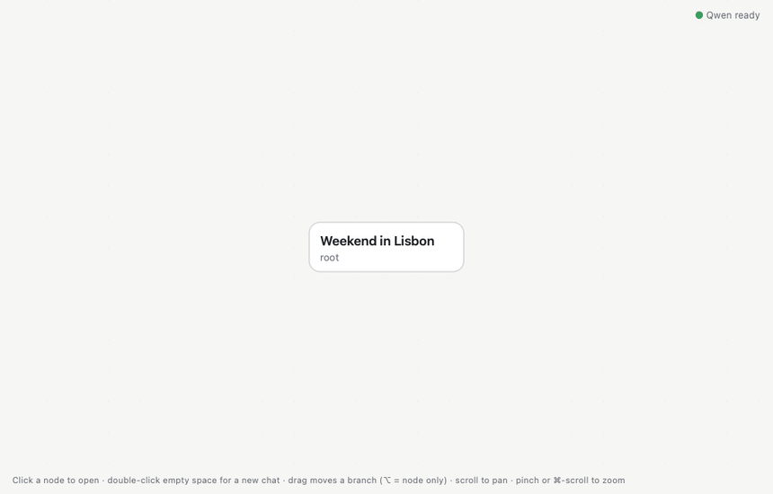
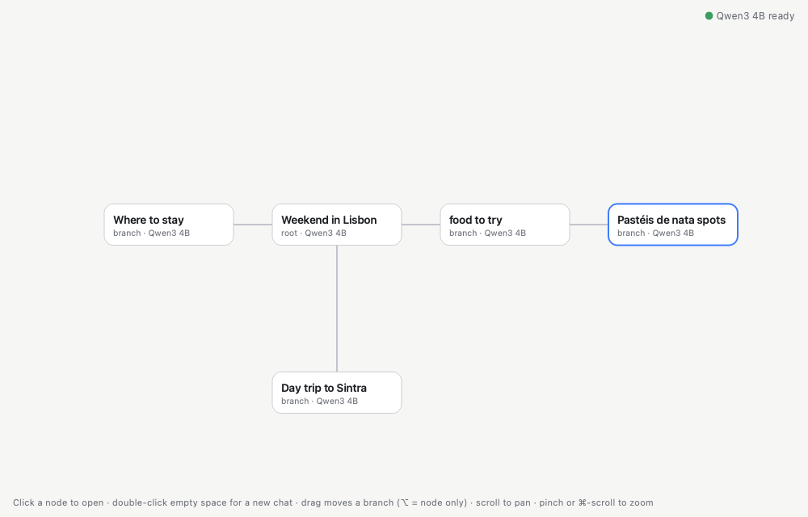
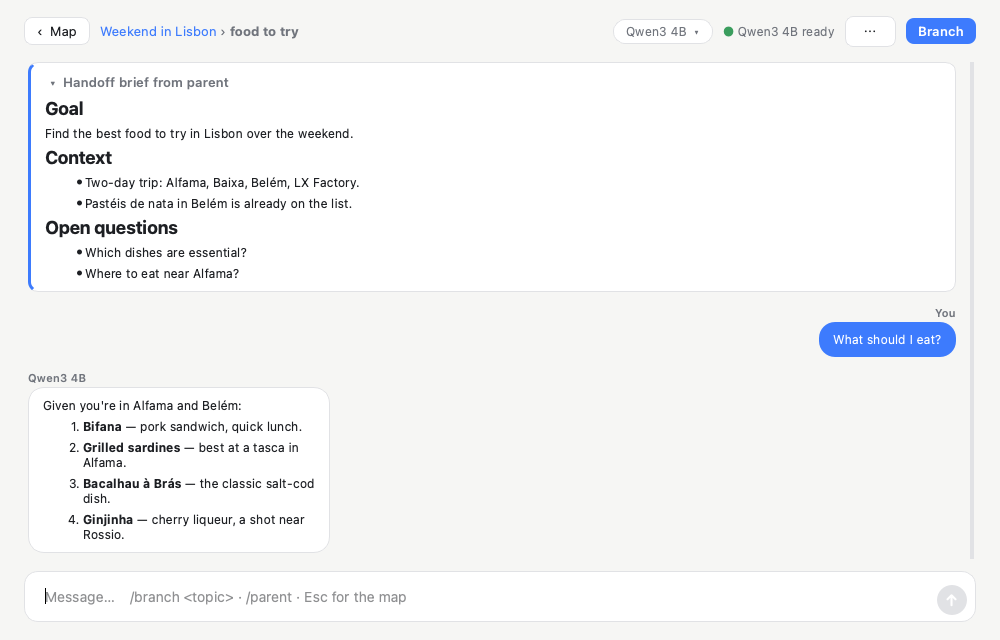

<p align="center">
  
</p>

<h1 align="center">Mind Map</h1>

<p align="center">
  <b>A local LLM chat where every conversation is a node on a 2D mind map.</b><br>
  Branch side topics into new chats, carry the context with an editable handoff brief,
  and find your way back by where things are on the map.
</p>

<p align="center">
  <a href="https://github.com/gmgreenfield/mind-map/actions/workflows/tests.yml"></a>
  <a href="https://github.com/gmgreenfield/mind-map/releases/latest"></a>
  <a href="LICENSE"></a>
</p>

<p align="center">
  
</p>

## Why

Long chats drift. A side question about food derails the trip plan, and later you
can't find either thread. Mind Map treats each topic as its own chat and lays them out
spatially:

- **Branch anything.** Type `/branch food to try` and the model writes a short
  **handoff brief** (goal, relevant context, open questions) from the current chat.
  You edit it, confirm, and the camera pivots to the new child chat.
- **Children see only the brief**, not the parent's whole history. Each chat stays
  focused, and context stays small, which suits a small local model.
- **The map is the interface.** No sidebars, no chat list. Click a node to zoom into
  it, press Esc to zoom out, drag branches around, and move between connected chats
  with ⌘ + arrow keys.
- **Fully local.** Runs [Qwen3-4B-Instruct-2507](https://huggingface.co/Qwen/Qwen3-4B-Instruct-2507)
  through [llama.cpp](https://github.com/ggml-org/llama.cpp) on your Mac. Nothing leaves
  your machine.

<p align="center">
  
  
</p>

## Install

**Requirements:** a Mac, about 3 GB of free disk space (the model is ~2.5 GB) and 8 GB+ RAM.
It runs on the CPU, so Intel Macs work (tested on an Intel i7 with macOS 26). Apple Silicon should be faster.

### Download the app

From the [latest release](https://github.com/gmgreenfield/mind-map/releases/latest), download
`Mind-Map-macOS-arm64.zip` (Apple Silicon) or `Mind-Map-macOS-x64.zip` (Intel), unzip it
and move **Mind Map.app** to Applications.

The app isn't signed by Apple, so the first time, **right-click it → Open → Open**.
On first launch it downloads the model (~2.5 GB) and then starts in a few seconds after that.

### Run from source

```bash
git clone https://github.com/gmgreenfield/mind-map.git
cd mind-map
python3 -m venv .venv && .venv/bin/pip install -r requirements.txt
```

You also need `llama-server` from llama.cpp. Download the macOS build for your chip from the
[llama.cpp releases](https://github.com/ggml-org/llama.cpp/releases)
(`llama-<build>-bin-macos-arm64.tar.gz` or `-x64`), then:

```bash
mkdir -p ~/.local/llama.cpp && tar -xzf llama-*-bin-macos-*.tar.gz -C ~/.local/llama.cpp
ln -sfn ~/.local/llama.cpp/llama-<build> ~/.local/llama.cpp/current

.venv/bin/python -m mindmap            # starts llama-server for you
.venv/bin/python -m mindmap --mock --demo   # try it with no model at all
```

## Using it

| Action | How |
|---|---|
| Open a chat | Click its node |
| Back to the map | **Esc** or **‹ Map** |
| New topic | Double-click empty space on the map |
| Branch the current chat | `/branch <topic>` or **Branch** |
| Go to the parent | `/parent`, or click it in the breadcrumb |
| Move to a connected chat | **⌘ + arrow** (when the message box is empty) |
| Move a branch | Drag a node (its children follow). **⌥-drag** moves just that node |
| Rename or delete | Right-click a node, or **⋯** in a chat |
| Pan / zoom | Scroll / pinch or ⌘-scroll |

## How branching works

```
Parent chat ──/branch food──▶ Qwen writes a brief ──▶ you edit it ──▶ child chat
                                (from the transcript)                  (sees only the brief)
```

The brief is generated from the parent chat, passed as a quoted transcript. With a 4B
model, this works much more reliably than asking it to summarise its own chat turns,
which sometimes made it reverse conclusions. Replies are capped and told to be brief,
so a CPU-only Mac stays responsive.

## Development

```bash
.venv/bin/pytest                         # ~140 tests, including UI tests (offscreen)
.venv/bin/python -m mindmap --mock --demo  # mock model + an example map
scripts/build_app.sh                     # build dist/Mind Map.app
.venv/bin/python scripts/make_demo.py docs # re-record the demo GIF
```

The tests include end-to-end runs of the real window with a mock model: deep branch
chains, concurrent replies, drag and reload from disk, and random sequences of user actions.

```
mindmap/
  store.py        SQLite: sessions (nodes) and messages
  branching.py    chat context, handoff brief prompt
  layout.py       where new branches go, ⌘-arrow navigation
  llm.py          streaming client for llama-server
  server.py       starts and stops llama-server
  mock_llm.py     scripted model for tests and demos
  ui/             map, chat, brief dialog, main window
```

## Credits

Built with [PySide6](https://doc.qt.io/qtforpython-6/), [llama.cpp](https://github.com/ggml-org/llama.cpp)
(MIT) and [Qwen3](https://github.com/QwenLM/Qwen3) (Apache 2.0).

## License

[MIT](LICENSE)
